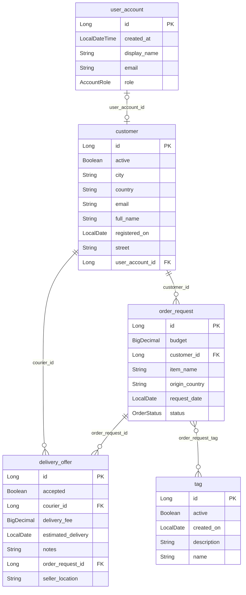

# Schemat bazy danych

Plik generują reguły projektu (panel Maven → Lifecycle → verify). Nie edytujcie go ręcznie.

Tabele: 6 (w tym tabele łączące @ManyToMany: order_request_tag) · kolumny: 34 · relacje: 3 × @ManyToOne, 3 × @OneToMany, 1 × @OneToOne, 1 × @ManyToMany

| Tabela | Encja | Kolumny | Klucze obce |
|---|---|---|---|
| customer | Customer | 9 | user_account_id |
| delivery_offer | DeliveryOffer | 8 | courier_id, order_request_id |
| order_request | OrderRequest | 7 | customer_id |
| tag | Tag | 5 | — |
| user_account | UserAccount | 5 | — |

